# 电流环力矩估计精度评估报告

- 场景: **synthetic-sine**
- 采样: 121 帧 @ 100.00 Hz, 分析窗 1.20 s
- 固件: `synthetic-example`; 几何指纹: `640bf04bf532e395`
- 重力向量: [0.0, 0.0, -9.81] (台架若为 +Y 请用 `--gravity 0,9.81,0`)
- payload: {'mass': 0.0, 'com': [0.0, 0.0, 0.0]}
- 摩擦模型: 固件 friction_model=1

## 结论摘要

- 逐轴平均 RMSE (raw): **0.0000 N·m**; 最大 0.0000 N·m (J2)
- 逐轴平均 |bias|: 0.0000 N·m; 平均相对 RMSE: 0.000
- 固件前馈口径 (scaled) 平均 RMSE: **0.0000 N·m**

主要误差来源 (按证据排序, 不是最终判决):

- **模型与实测高度一致** — 平均相对 RMSE 0.00% (<2%), 残差已接近滤波/数值噪声
  - 建议: 若为合成/回放数据, 说明采集-逆动力学链路正确; 若为真机数据, 精度已优于 2%, 结论限定在本组构型与速度范围内即可。

## 方法与口径

- 模型: 固件在线读回的刚体参数 + jm + payload 复合 (`model.json`, 几何来自 `dyn_model_data.h`)。
- 逆动力学: 世界系牛顿-欧拉 RNEA (固件 `rnea_core_m` 的逐行移植), `τ = M·ddq + C·dq + G + jm·ddq + friction`。
- 滤波: 零相位 Butterworth (filtfilt), q/dq 15.0 Hz, ddq 5.0 Hz, τ 10.0 Hz; ddq 由 dq 中心差分后再低通。
- 边沿裁剪: 0.400 s (默认 `max(2/cutoff_ddq, 0.1)`, 上限 span/5), 避开零相位滤波两端瞬态。
- 残差定义: `τ_meas − τ_model`, 关节侧, N·m; `raw` 为物理量, `scaled` 按固件 gravity_scale/inertia_scale 口径。

## 逐轴指标 (raw)

| 关节 | RMSE | MAE | bias | peak | rel_RMSE | R² | corr | RMSE (scaled) |
|---|---|---|---|---|---|---|---|---|
| J1 | 0.0000 | 0.0000 | -0.0000 | 0.0000 | 0.000 | 1.000 | 1.000 | 0.0000 |
| J2 | 0.0000 | 0.0000 | 0.0000 | 0.0000 | 0.000 | 1.000 | 1.000 | 0.0000 |
| J3 | 0.0000 | 0.0000 | -0.0000 | 0.0000 | 0.000 | 1.000 | 1.000 | 0.0000 |
| J4 | 0.0000 | 0.0000 | 0.0000 | 0.0000 | 0.000 | 1.000 | 1.000 | 0.0000 |
| J5 | 0.0000 | 0.0000 | 0.0000 | 0.0000 | 0.000 | 1.000 | 1.000 | 0.0000 |
| J6 | 0.0000 | 0.0000 | 0.0000 | 0.0000 | 0.000 | 1.000 | 1.000 | 0.0000 |
| J7 | 0.0000 | 0.0000 | -0.0000 | 0.0000 | 0.000 | 1.000 | 1.000 | 0.0000 |

## 按速度分层 (raw RMSE, N·m)

| 关节 | slow_[0.05,0.3) | static_[0,0.05) |
|---|---|---|
| J1 | 0.0000 | 0.0000 |
| J2 | 0.0000 | 0.0000 |
| J3 | 0.0000 | 0.0000 |
| J4 | 0.0000 | — |
| J5 | 0.0000 | — |
| J6 | 0.0000 | — |
| J7 | 0.0000 | 0.0000 |

## 延迟扫描

lag > 0 = 实测相对模型滞后; improvement = 时移后可再降的 RMSE 比例。

| 关节 | 最优 lag (ms) | 零时移 RMSE | 最优 RMSE | 可改善 |
|---|---|---|---|---|
| J1 | 0.00 | 0.0000 | 0.0000 | 0.0% |
| J2 | 0.00 | 0.0000 | 0.0000 | 0.0% |
| J3 | 0.00 | 0.0000 | 0.0000 | 0.0% |
| J4 | 0.00 | 0.0000 | 0.0000 | 0.0% |
| J5 | 0.00 | 0.0000 | 0.0000 | 0.0% |
| J6 | 0.00 | 0.0000 | 0.0000 | 0.0% |
| J7 | 0.00 | 0.0000 | 0.0000 | 0.0% |

## 残差与其他项的相关

| 关节 | 静止 bias | r(G) | r(I) | r(F) | r(sign dq) | r(ddq) |
|---|---|---|---|---|---|---|
| J1 | -0.0000 | — | 0.99 | — | -0.64 | 0.94 |
| J2 | 0.0000 | -0.98 | 0.99 | — | 0.33 | -0.98 |
| J3 | -0.0000 | 0.82 | 0.99 | — | -0.10 | 0.93 |
| J4 | 0.0000 | -0.94 | 0.99 | — | — | -0.99 |
| J5 | — | 0.03 | 1.00 | — | — | -0.99 |
| J6 | — | -0.98 | 0.98 | — | — | -0.99 |
| J7 | -0.0000 | -0.99 | -0.86 | — | -0.24 | -0.99 |

## 各理论项 RMS (N·m)

| 关节 | G | C | I | jm·ddq | friction |
|---|---|---|---|---|---|
| J1 | 0.0000 | 0.0041 | 0.0574 | 0.0000 | 0.0000 |
| J2 | 1.6264 | 0.0077 | 0.0687 | 0.0000 | 0.0000 |
| J3 | 0.0152 | 0.0040 | 0.0637 | 0.0068 | 0.0000 |
| J4 | 0.5922 | 0.0035 | 0.0483 | 0.0077 | 0.0000 |
| J5 | 0.0007 | 0.0008 | 0.0039 | 0.0019 | 0.0000 |
| J6 | 0.0742 | 0.0011 | 0.0089 | 0.0062 | 0.0000 |
| J7 | 0.0024 | 0.0015 | 0.0023 | 0.0049 | 0.0000 |

## 图

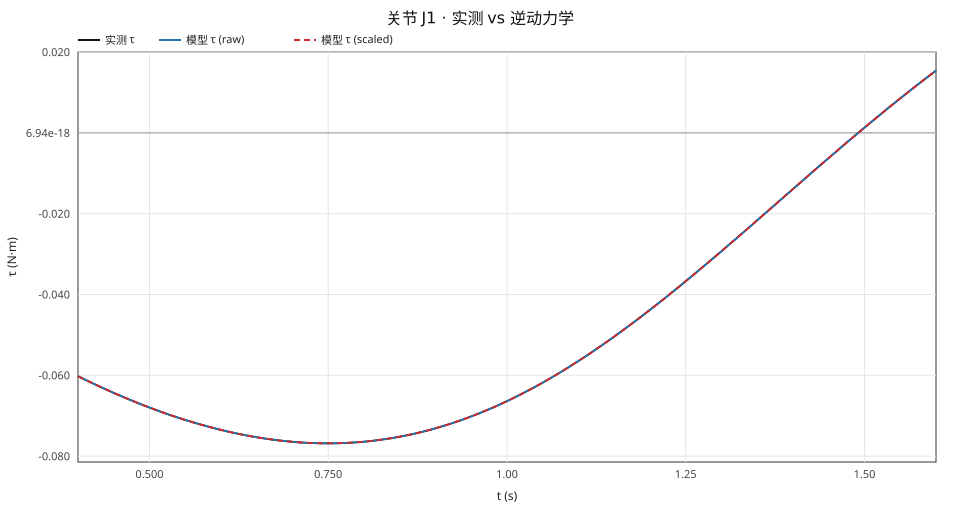

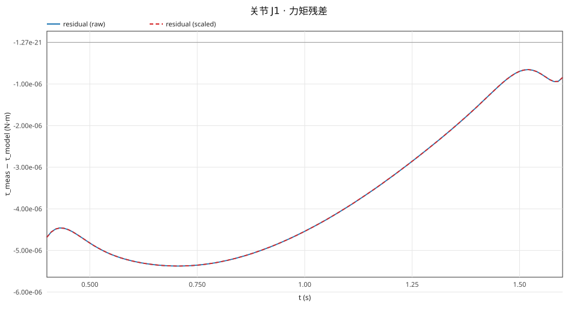

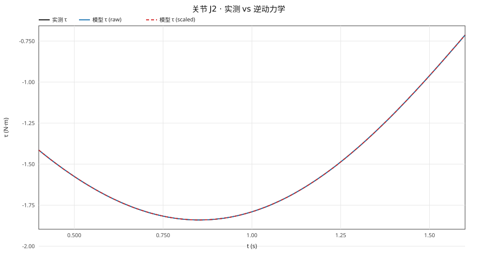

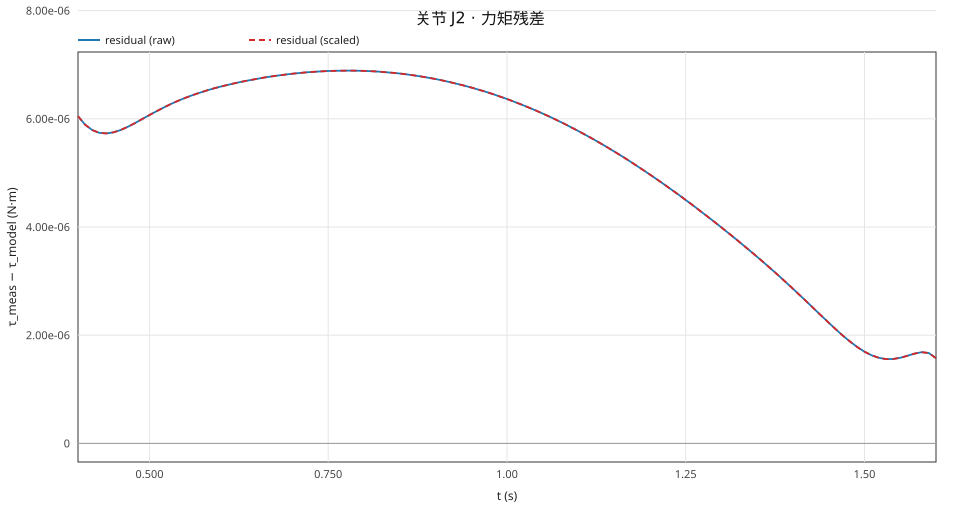

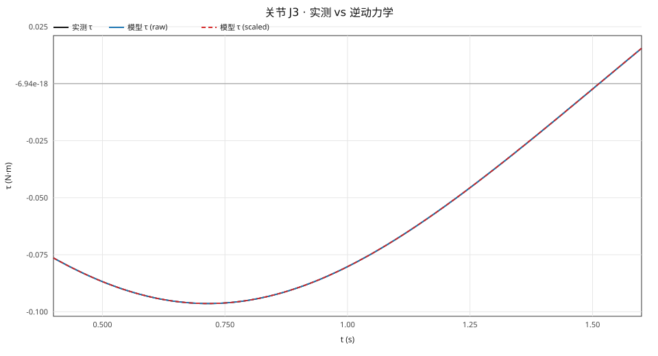

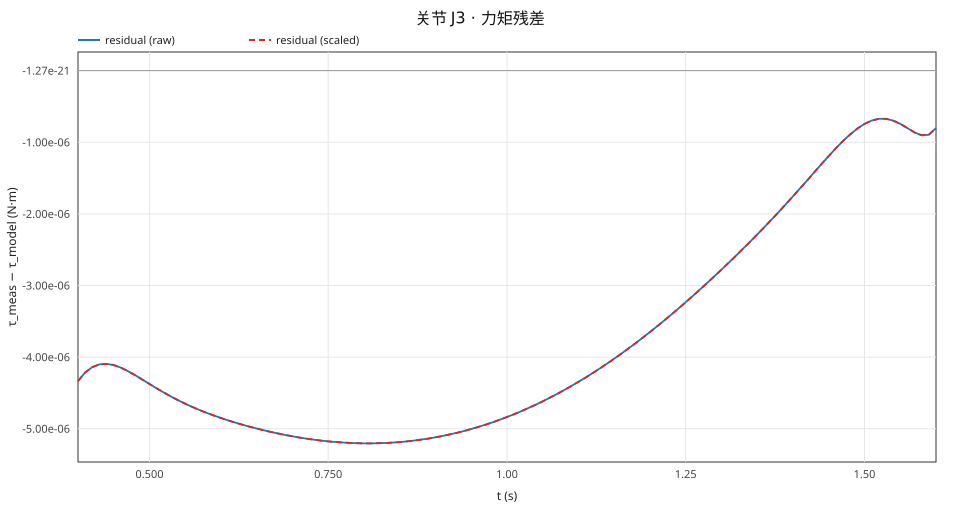

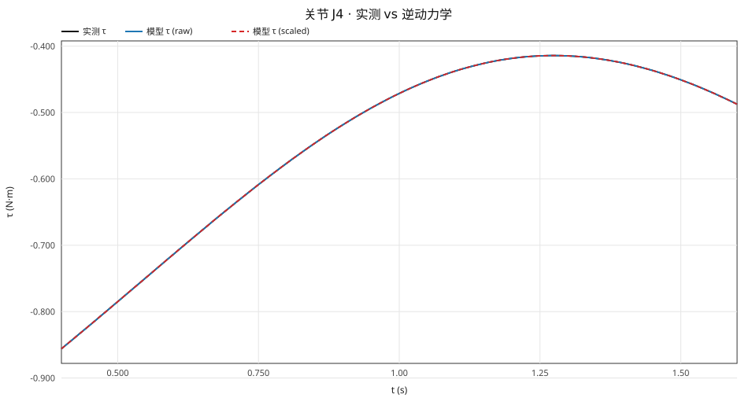

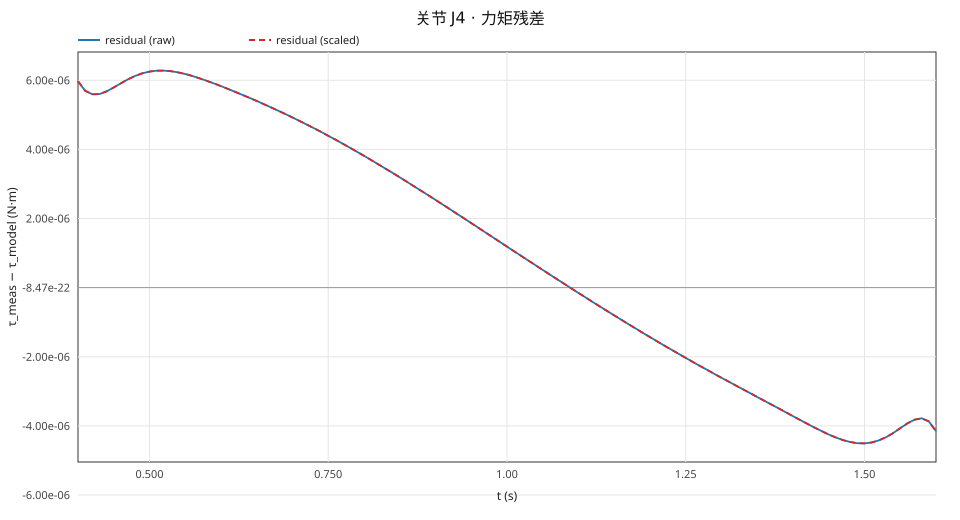

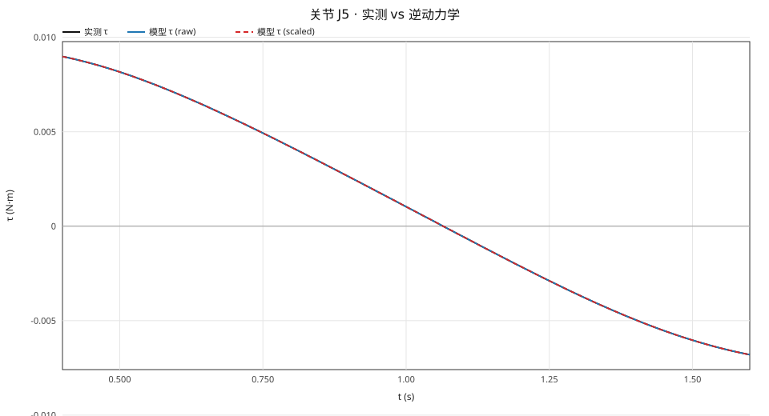

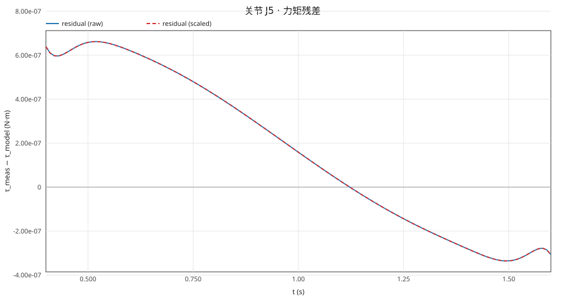

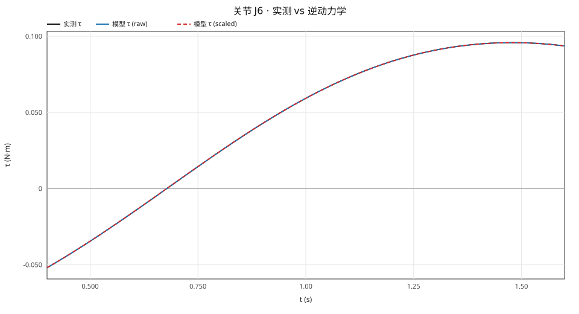

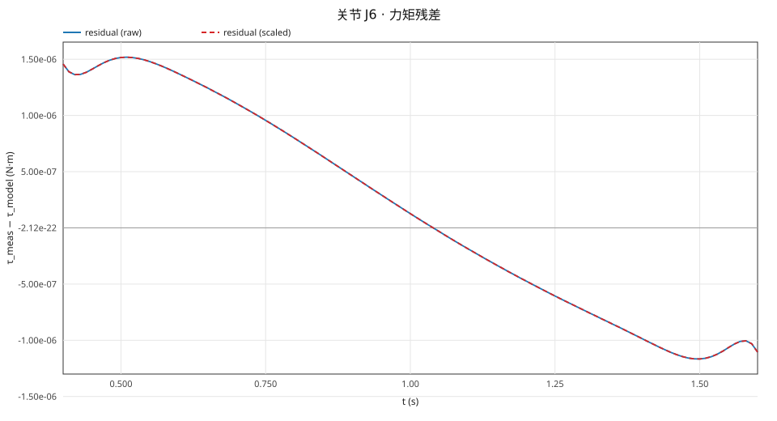

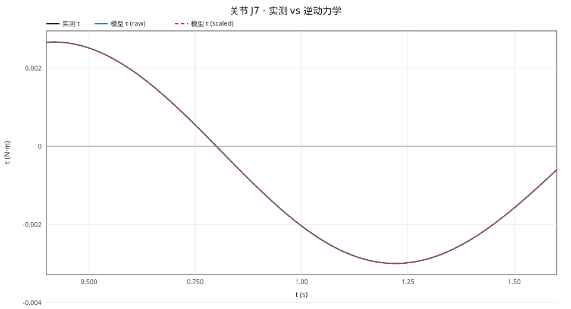

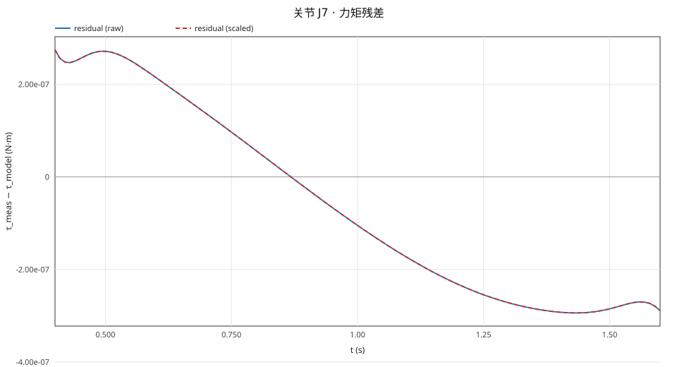

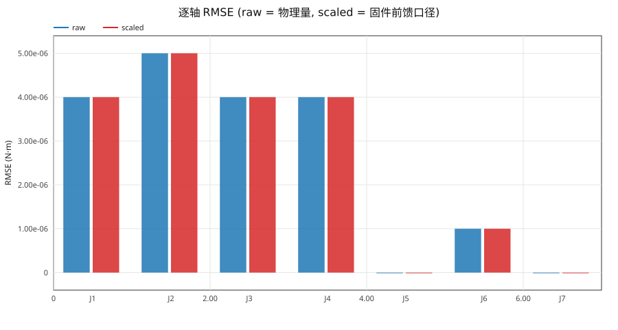

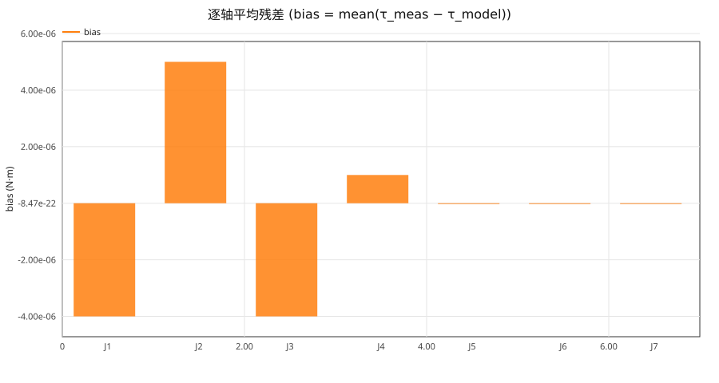

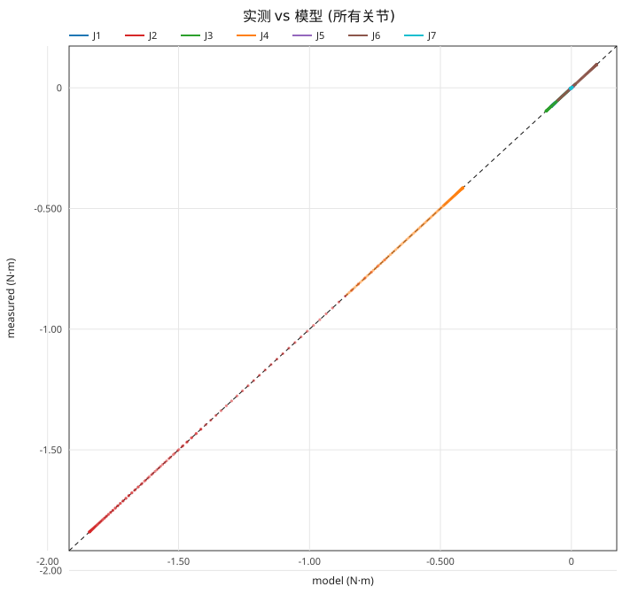

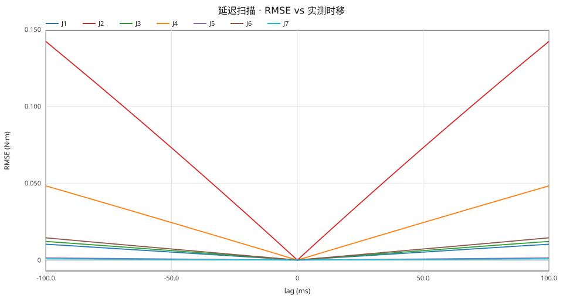

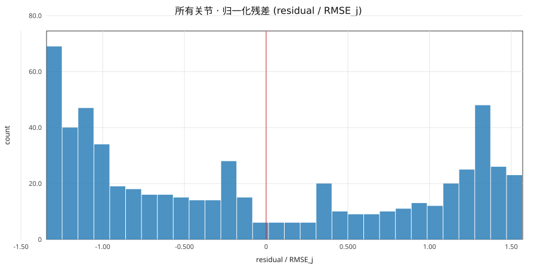

## 复现

```
python3 examples/make_synthetic.py
```

## 限制

- τ 是**电流环估计值**, 不是关节力矩传感器; 电流环标定误差会直接进入结论。
- 固件模型是辨识回归量: link mass 多为 1、惯量含负值、M 不正定; 只用于前向计算, **不可求 M⁻¹**。
- `get_gravity` 的静态核查只在末段静止时有效; 运动段不冒充静态。
- 环境温度读不到, 报告里的温度是电机绕组/MOS 温度; ambient 只能用 `--ambient-c` 手工记录。
- 结论的适用范围是本组构型与速度; 外推到限位附近/高速段需另采数据。
